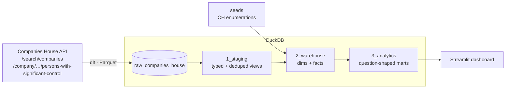

# Companies House search warehouse

A small, production-shaped data platform that answers the Sonovate tech-test questions about the
Companies House API. It is built as a reusable warehouse rather than a one-off script: search terms
are configuration, the questions are answered by the analytics layer, and a Streamlit dashboard
presents the answers.



| Layer | Tool | Notes |
|---|---|---|
| Ingestion | **dlt** | REST client with offset pagination, basic auth, retry/backoff on 429/5xx, Parquet load files |
| Storage | **DuckDB** | Single file, zero infrastructure, so anyone can run it ([production path](#production-path)) |
| Transformation | **dbt** | `1_staging` → `2_warehouse` → `3_analytics`, with schema tests and unit tests |
| Visualisation | **Streamlit** | Local dashboard over the analytics layer |
| CI/CD | **GitHub Actions** | Lint + tests on every PR; scheduled pipeline run builds the warehouse |

## Quickstart

Prerequisites are [uv](https://docs.astral.sh/uv/) and a free
[Companies House API key](https://developer.company-information.service.gov.uk/).

```bash
make install
touch .env                  # add your API key (see below)
make run                    # ingest -> dbt build
make app                    # answers dashboard at http://localhost:8501
```

`.env` should contain the following, with no quotes around the values (the Makefile passes them
through literally):

```
SOURCES__COMPANIES_HOUSE__API_KEY=your-key-here
DUCKDB_PATH=data/warehouse.duckdb
```

`make test` runs everything offline against a recorded API response, so no key is needed.
`make docs` opens dbt docs with lineage.

### Browsing the data

To explore the tables in a browser, install the [DuckDB CLI](https://duckdb.org/docs/installation/)
(`brew install duckdb`) and run from the repo root:

```bash
duckdb -ui data/warehouse.duckdb
```

Then open http://localhost:4213 in a normal browser (not the VS Code built-in one). Tables are
grouped by schema: `raw_companies_house` (as loaded by dlt), `staging`, `warehouse` and `analytics`.

- The UI only runs while that `duckdb` session is open, so leave the terminal at the `D` prompt.
- DuckDB allows one writer at a time, so quit the session (`.quit`) before running `make run` or
  `make app`, or they will fail with a lock error.

## Data model

- **`raw_companies_house`** (loaded by dlt): searches are appended as one snapshot per run;
  `companies` and `persons_with_significant_control` keep every version (SCD2).
- **`1_staging`** (views): rename, cast, unpack JSON and dedupe; expose the run (`load_id`) and
  SCD2 validity (`valid_from` / `valid_to` / `is_current`).
- **`2_warehouse`** (tables): a Kimball star with history.
  - `dim_company`, `dim_person_with_significant_control`: current versions; their `_history`
    tables hold every version.
  - `dim_company_type`, `dim_company_status`: descriptions seeded from
    [`companieshouse/api-enumerations`](https://github.com/companieshouse/api-enumerations).
  - `fct_company_searches`, `fct_company_search_results`: one row per run, flagged
    `is_latest_snapshot`.
- **`3_analytics`** (tables): what the dashboard reads, from the latest run and current versions
  only: `search_summary` (Q1–Q4), `search_companies` (Q5), `search_premises_by_company_type` (Q6)
  and `search_companies_with_pscs` (Explore Dataset: each company with its latest PSC).

## Design decisions and assumptions

- **"Match" means the API's standard search (`/search/companies`).** This is the endpoint the brief
  describes. It is a fuzzy, relevance-ranked search, so results can include names without the
  literal substring "sono". The advanced-search endpoint (`company_name_includes`) would give
  exact-substring semantics. It's a one-resource addition if that definition is preferred.
- **The 1,000-result cap.** The API counts every match (`total_results`) but only lets you page
  through the first 1,000. Q1 reports the API's count. Q2–Q6 are necessarily computed over the
  fetched set, and the dashboard flags it whenever these differ. The count comes from
  a separate one-item request so each dlt resource maps cleanly to one table.
- **Dissolved** means `company_status = 'dissolved'`. **Life** is `date_of_cessation - date_of_creation`
  in days.
- **Premises number**: every digit in `address.premises` is concatenated (`6-8` → 68, `14b` → 14,
  `1st Floor 45 Main St` → 145). A premises with no digits, or no premises at all, contributes
  nothing; the count is shown separately. This is one macro (`digits_to_number`) covered by a dbt unit test.
- **Parquet.** The data is small (≤1,000 rows per term), so Parquet isn't needed for volume. It is
  used because it carries types end to end: dates land as `DATE`, not strings. Nested objects
  (`address`, `links`, `matches`) land as JSON columns, so new API fields can't break the raw schema.
- **Searches are a full extract, history kept.** The search API has no "changed since" filter, so
  every run fetches all results again (about 11 requests per term). Searches are appended as
  snapshots, and companies and PSCs are SCD2:
  dlt hashes each record, opens a new version when the hash changes, and closes the open version of
  any record the run no longer returns (e.g. a company that dropped out of the top 1,000 or whose
  search term was removed). Companies are versioned on their attributes only (`COMPANY_FIELDS`),
  not on the term or rank they were found by, so ranking changes don't create versions. History
  starts from the first run: the API only returns current state, so the past can't be backfilled.
- **PSCs are extracted incrementally.** They cost one request per company, and neither endpoint
  says what changed, so a dlt transformer fetches a company's PSCs only when it is new, its
  attributes changed since the last fetch, or that fetch is older than `psc_refresh_days` (7, in
  `.dlt/config.toml`). The last fetch per company is kept in dlt's resource state, which is saved
  in the destination with each load, so a failed run doesn't advance it. The PSC table's SCD2 uses
  `merge_key="company_number"` so that only the fetched companies' PSCs can be closed.
  - A PSC-only change (no change to the company) shows up within `psc_refresh_days`.
  - Full refresh / backfill:
    `SOURCES__COMPANIES_HOUSE__PSC_REFRESH_DAYS=0 make run` re-fetches every company.
  - The first run, and any run after the refresh window lapses for every company, fetches them
    all. That exceeds the 600-requests-per-5-minutes limit for a full 1,000-result term, so the
    client reads the `X-Ratelimit-Remain` / `X-Ratelimit-Reset` headers and sleeps until the window
    resets, which takes a few minutes.
  - Companies with no PSC record (the API returns 404, e.g. those dissolved before the 2016
    register) have no rows. If a re-fetched company's PSCs disappear entirely, their versions stay
    open; the register keeps ceased PSCs, so this is rare.
- **Natural keys** (`company_number`) are used because they are stable, unique business identifiers.
- **Unknown enum values warn rather than fail.** If Companies House adds a company type, the
  relationship test warns and the analytics layer falls back to the raw code.

## Production path

DuckDB keeps this runnable on a laptop. In production I would point the same code at a cloud
warehouse such as **BigQuery** (or Snowflake). dlt and dbt make that a configuration change, not a
rewrite:

1. **Destination**: `dlt.destinations.bigquery()` in place of `duckdb`. Parquet load files go
   straight into BigQuery load jobs.
2. **dbt**: add a `bigquery` target to `profiles.yml` with `dbt-bigquery`. Most of the SQL ports
   as-is. The few dialect-specific bits are JSON `->>` (`JSON_VALUE`), `count(*) filter (…)`
   (`COUNTIF`), `arg_min` (`MIN_BY`), `date_diff` and the regex flag. Each sits behind
   `{{ dbt.datediff() }}` or a small `adapter.dispatch` macro, like the existing `digits_to_number`.
3. **Auth from GitHub Actions** with Workload Identity Federation, so no long-lived service-account keys:

   ```yaml
   permissions: { contents: read, id-token: write }
   steps:
     - uses: google-github-actions/auth@v3
       with:
         workload_identity_provider: projects/<num>/locations/global/workloadIdentityPools/github/providers/<repo>
         service_account: data-pipeline@<project>.iam.gserviceaccount.com
   ```

   Grant the service account `roles/bigquery.dataEditor` on the datasets and `roles/bigquery.jobUser`
   on the project, restricted to this repository via the provider's attribute condition.
4. **Separate environments**: dev and prod datasets via dbt targets, with `--target prod` only from
   `main`.
5. **Persistent history**: the scheduled workflow starts from an empty DuckDB file, so snapshots
   and SCD2 versions only build up where the file persists (locally). A cloud warehouse (item 1)
   keeps them between runs. For true CDC, the Companies House Streaming API pushes company and
   PSC change events with a resumable `timepoint`.
6. **Observability**: source freshness on `searched_at`, dlt load info shipped to a monitoring
   table, and alerts on test failures.
7. **Enrichment**: the `/company/{number}` profile endpoint (SIC codes, accounts, officers) as
   further dlt transformers, following the incremental PSC one. Spreading each company's refresh
   across the window (rather than all expiring on the same day) would even out the rate-limit load.
