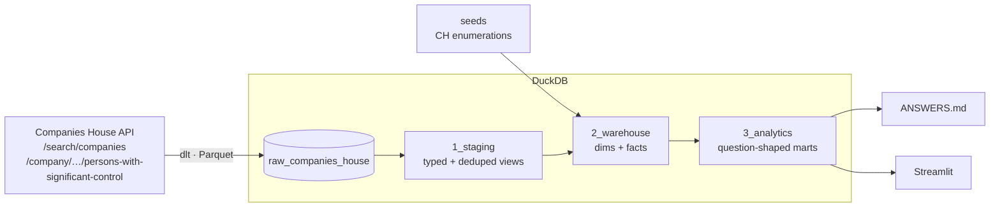

# Companies House search warehouse

A small, production-shaped data platform that answers the Sonovate tech-test questions about the
Companies House API. It is built as a reusable warehouse rather than a one-off script: search terms
are configuration, the questions are answered by the analytics layer, and the same models serve the
dashboard.



| Layer | Tool | Notes |
|---|---|---|
| Ingestion | **dlt** | REST client with offset pagination, basic auth, retry/backoff on 429/5xx, Parquet load files |
| Storage | **DuckDB** | Single file, zero infrastructure, so anyone can run it ([production path](#production-path)) |
| Transformation | **dbt** | `1_staging` → `2_warehouse` → `3_analytics`, with schema tests and unit tests |
| Visualisation | **Streamlit** | Local dashboard over the analytics layer |
| CI/CD | **GitHub Actions** | Lint + tests on every PR; scheduled pipeline run publishes the answers |

## Quickstart

Prerequisites are [uv](https://docs.astral.sh/uv/) and a free
[Companies House API key](https://developer.company-information.service.gov.uk/).

```bash
make install
touch .env                  # add your API key (see below)
make run                    # ingest -> dbt build -> ANSWERS.md
make app                    # dashboard at http://localhost:8501
```

`.env` should contain the following, with no quotes around the values (the Makefile passes them
through literally):

```
SOURCES__COMPANIES_HOUSE__API_KEY=your-key-here
DUCKDB_PATH=data/warehouse.duckdb
```

`make test` runs everything offline against a recorded API response, so no key is needed.
`make docs` opens dbt docs with lineage.

### Browsing the data

To explore the tables in a browser, install the [DuckDB CLI](https://duckdb.org/docs/installation/)
(`brew install duckdb`) and run from the repo root:

```bash
duckdb -ui data/warehouse.duckdb
```

Then open http://localhost:4213 in a normal browser (not the VS Code built-in one). Tables are
grouped by schema: `raw_companies_house` (as loaded by dlt), `staging`, `warehouse` and `analytics`.

- The UI only runs while that `duckdb` session is open, so leave the terminal at the `D` prompt.
- DuckDB allows one writer at a time, so quit the session (`.quit`) before running `make run` or
  `make app`, or they will fail with a lock error.

## Answers

`make run` writes **[`ANSWERS.md`](ANSWERS.md)**. The scheduled GitHub Actions run also publishes it
to the run summary.

| # | Question | Answered by |
|---|---|---|
| 1 | How many companies match "sono"? | `search_summary.total_results` |
| 2 | How many are active? | `search_summary.active_companies` |
| 3 | Average life of dissolved companies (days) | `search_summary.avg_dissolved_lifespan_days` |
| 4 | When was the first limited partnership created? | `search_summary.first_limited_partnership_incorporated_on` |
| 5 | Which also have "vate" in their name? | `search_companies` filtered by name (parameter in `reporting/answers.py` and the app) |
| 6 | Sum of premises digits by company type | `search_premises_by_company_type.premises_number_sum` |

To answer the same questions for a different term, add it to `search_terms` in `.dlt/config.toml`
and run `make run && uv run python -m reporting.answers --term <term>`. No model changes are needed.

## Data model

**`raw_companies_house`** (loaded by dlt): every run is a full extract, but nothing is overwritten.

| Table | Write disposition | Holds |
|---|---|---|
| `company_searches`, `company_search_results` | `append` | One snapshot per run, identified by dlt's `_dlt_load_id` |
| `companies` | `merge` / `scd2` | One row per version of each company, with `_dlt_valid_from` / `_dlt_valid_to` |
| `persons_with_significant_control` | `merge` / `scd2` | One row per version of each PSC |

**`1_staging`** (views): one model per source table. It renames, casts, extracts the address from
JSON, exposes the run as `load_id` / `loaded_at` and SCD2 validity as `valid_from` / `valid_to` /
`is_current`, and dedupes results that offset pagination can repeat.

**`2_warehouse`** (tables): a small Kimball star with history.

| Model | Grain | Purpose |
|---|---|---|
| `dim_company` | company | Current version: attributes plus derived `lifespan_days` and `premises_number`. Conformed across search terms. |
| `dim_company_history` | company × version | Every version (SCD2), e.g. when a company went from active to dissolved |
| `dim_person_with_significant_control` | PSC | Current version of the current and ceased PSCs of each company in `dim_company`. Not used by the answers. |
| `dim_person_with_significant_control_history` | PSC × version | Every version (SCD2) |
| `dim_company_type` / `dim_company_status` | enum value | Descriptions seeded from [`companieshouse/api-enumerations`](https://github.com/companieshouse/api-enumerations) |
| `fct_company_search_results` | run × search term × company | Factless fact: which companies a search returned, and at what rank |
| `fct_company_searches` | run × search term | API `total_results` vs. results fetched, with an `is_truncated` flag |

Both facts carry `is_latest_snapshot`, true for the most recent run.

**`3_analytics`** (tables): denormalised, question-shaped marts that the answers script and the
dashboard read. They use the latest run and current versions only, and don't contain any logic the
warehouse doesn't already have.

## Design decisions and assumptions

- **"Match" means the API's standard search (`/search/companies`).** This is the endpoint the brief
  describes. It is a fuzzy, relevance-ranked search, so results can include names without the
  literal substring "sono". The advanced-search endpoint (`company_name_includes`) would give
  exact-substring semantics. It's a one-resource addition if that definition is preferred.
- **The 1,000-result cap.** The API counts every match (`total_results`) but only lets you page
  through the first 1,000. Q1 reports the API's count. Q2–Q6 are necessarily computed over the
  fetched set, and `ANSWERS.md` and the dashboard flag it whenever these differ. The count comes from
  a separate one-item request so each dlt resource maps cleanly to one table.
- **Dissolved** means `company_status = 'dissolved'`. **Life** is `date_of_cessation - date_of_creation`
  in days.
- **Premises number**: every digit in `address.premises` is concatenated (`6-8` → 68, `14b` → 14,
  `1st Floor 45 Main St` → 145). A premises with no digits, or no premises at all, contributes
  nothing; the count is shown separately. This is one macro (`digits_to_number`) covered by a dbt unit test.
- **Parquet.** The data is small (≤1,000 rows per term), so Parquet isn't needed for volume. It is
  used because it carries types end to end: dates land as `DATE`, not strings. Nested objects
  (`address`, `links`, `matches`) land as JSON columns, so new API fields can't break the raw schema.
- **Full extract, history kept.** The search API has no "changed since" filter, so every run
  fetches everything again. Searches are appended as snapshots, and companies and PSCs are SCD2:
  dlt hashes each record, opens a new version when the hash changes, and closes the open version of
  any record the run no longer returns (e.g. a company that dropped out of the top 1,000 or whose
  search term was removed). Companies are versioned on their attributes only (`COMPANY_FIELDS`),
  not on the term or rank they were found by, so ranking changes don't create versions. History
  starts from the first run: the API only returns current state, so the past can't be backfilled.
- **Persons with significant control** are fetched by a dlt transformer, one request per company
  that any search returned. That is roughly one request per result, which exceeds the API's
  600-requests-per-5-minutes limit for a full 1,000-result term. The client reads the
  `X-Ratelimit-Remain` / `X-Ratelimit-Reset` headers and sleeps until the window resets rather than
  being throttled, so `make run` takes a few minutes. Companies with no PSC record (the API returns
  404, e.g. those dissolved before the 2016 register) simply have no rows.
- **Natural keys** (`company_number`) are used because they are stable, unique business identifiers.
- **Unknown enum values warn rather than fail.** If Companies House adds a company type, the
  relationship test warns and the analytics layer falls back to the raw code.

## Testing

| Level | What | Where |
|---|---|---|
| Unit (Python) | Pagination, 100-per-page, stopping at the 1,000 cap, true total, auth header, 429 retry, 401 failure | `tests/test_companies_house.py` (mocked HTTP) |
| Unit (SQL) | Premises digits, lifespan incl. leap years, latest-attributes-win, Q2–Q4 aggregation | dbt `unit_tests` in the model YAML |
| Data quality | Uniqueness, not-null, referential integrity, enum membership | dbt `data_tests` |
| End to end | Recorded API response → dlt → dbt build → answers, one test per question | `tests/test_end_to_end.py` |

The end-to-end tests read as the spec: *given* this API response, *then* Q2 is 3 active companies,
and so on. The fixture companies are synthetic, and the expected values are worked out by hand in the tests.

## CI/CD

- **`ci.yml`** runs on every PR/push: `ruff` lint and format check, then the full test suite. It needs
  no secrets because the API is mocked.
- **`pipeline.yml`** runs weekly and on demand: `make run` with the `COMPANIES_HOUSE_API_KEY` repo
  secret, then publishes `ANSWERS.md` to the run summary and uploads it with the DuckDB file as a build artifact.

## Production path

DuckDB keeps this runnable on a laptop. In production I would point the same code at a cloud
warehouse such as **BigQuery** (or Snowflake). dlt and dbt make that a configuration change, not a
rewrite:

1. **Destination**: `dlt.destinations.bigquery()` in place of `duckdb`. Parquet load files go
   straight into BigQuery load jobs.
2. **dbt**: add a `bigquery` target to `profiles.yml` with `dbt-bigquery`. Most of the SQL ports
   as-is. The few dialect-specific bits are JSON `->>` (`JSON_VALUE`), `count(*) filter (…)`
   (`COUNTIF`), `arg_min` (`MIN_BY`), `date_diff` and the regex flag. Each sits behind
   `{{ dbt.datediff() }}` or a small `adapter.dispatch` macro, like the existing `digits_to_number`.
3. **Auth from GitHub Actions** with Workload Identity Federation, so no long-lived service-account keys:

   ```yaml
   permissions: { contents: read, id-token: write }
   steps:
     - uses: google-github-actions/auth@v3
       with:
         workload_identity_provider: projects/<num>/locations/global/workloadIdentityPools/github/providers/<repo>
         service_account: data-pipeline@<project>.iam.gserviceaccount.com
   ```

   Grant the service account `roles/bigquery.dataEditor` on the datasets and `roles/bigquery.jobUser`
   on the project, restricted to this repository via the provider's attribute condition.
4. **Separate environments**: dev and prod datasets via dbt targets, with `--target prod` only from
   `main`.
5. **Persistent history**: the scheduled workflow starts from an empty DuckDB file, so snapshots
   and SCD2 versions only build up where the file persists (locally). A cloud warehouse (item 1)
   keeps them between runs. For true CDC, the Companies House Streaming API pushes company and
   PSC change events with a resumable `timepoint`.
6. **Observability**: source freshness on `searched_at`, dlt load info shipped to a monitoring
   table, and alerts on test failures.
7. **Enrichment**: the `/company/{number}` profile endpoint (SIC codes, accounts, officers) as
   further dlt transformers, following the PSC one. With more per-company endpoints, fetch PSCs
   incrementally (only new or changed companies) to stay within the rate limit.

## Layout

```
ingestion/            dlt source (companies_house.py) and pipeline entrypoint
transform/            dbt project: models/{1_staging,2_warehouse,3_analytics}, seeds, macros
reporting/answers.py  analytics layer -> ANSWERS.md
app/                  Streamlit dashboard
tests/                pytest: unit, end-to-end, fixtures
.github/workflows/    ci.yml, pipeline.yml
```
